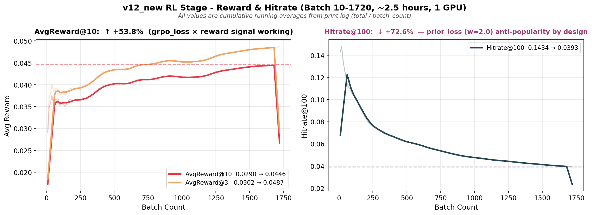
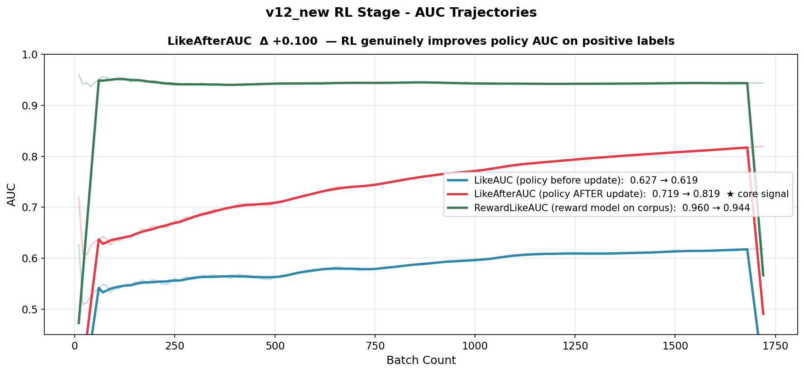
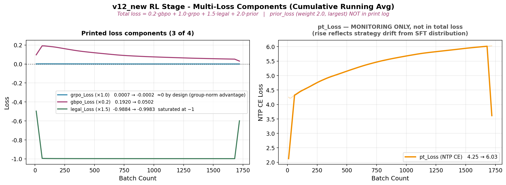
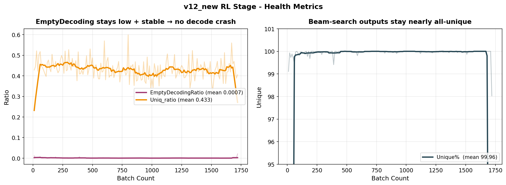

# v12_new RL 阶段训练总结

> 数据源：`/data04/search/tanxiaofeng/dev/onerec_v12_new/log/log_grpo_neg_sample`
> 9-19 成功 run（2025-09-19 14:31 → 17:00），172 个 batch 采样点（每 10 batch 打 1 行 → ~1720 个 batch）。
> 9-17 那次崩溃 run（`log_2025091718`，3.1 GB）作为时间线对照，不参与曲线。

---

## 1. 训练参数

### 1.1 任务 / 起点

| 参数 | 值 | 含义 |
|---|---|---|
| **训练入口** | `train_grpo_neg_sample.py` | RL 主脚本（GRPO + GBPO 混合 + legal + prior）|
| **启动脚本** | `run_reward.sh` | `nohup python -u train_grpo_neg_sample.py --corpus_day 1 --with_today True` |
| **resume 起点** | `sft_model/checkpoint-302596.pt` | 接 SFT 阶段终点；由 logger 旁路日志 `log_2025091914` 实证（`Loaded checkpoint from ... at step 302596`）|
| **`corpus_day`** | 1 | 训练 1 天的曝光语料 |
| **`with_today`** | True | 包含当天数据（与 PT/SFT 都不一样）|
| **URL 词典** | 同 PT/SFT 9,196,859 条 | 词典在三阶段不变 |
| **reward 服务** | `10.177.75.200:9503` | 外部 TF Serving；模型走在线打分 |

### 1.2 模型规模

模型结构、参数量与 PT/SFT 一致，单卡只更新 Transformer 主干 + 实际命中的 sparse 行。

| 参数 | 值 |
|---|---|
| **总参数量** | 2.00 B |
| **Sparse Embedding** | 1.99 B |
| **Dense 参数** | ~10 M |
| **Codebook 层数** | 3 |
| **Codebook 词表** | 1502 |

### 1.3 训练超参

| 参数 | 值 | 含义 |
|---|---|---|
| **Batch Size（名义）** | 1024 | `data_args.batch_size` 默认值，dataloader 一个 batch 的目标 user 数 |
| **Batch Size（实际进 RL）** | mean **34.2**（21~46）| log 里 `real_batch_size` 字段：每 batch 过滤掉空 / 全负 / 解码失败的样本后，真正参与策略更新的 user 数 |
| **G（每 user 采样条数）** | **100** | `num_samples_per_input`；每个 user 通过 beam-search 生成 100 条候选 URL 序列 |
| **每步前向样本** | **~3,434** | `real_batch × (G+1) ≈ 34 × 101`（额外 +1 是真实曝光样本）|
| **`grpo_epochs_per_batch`** | **4** | 每个 batch 在策略上反复优化 4 轮（off-policy → on-policy 修正）|
| **采样策略** | top-p | `strategy="topp"`, `top_p=1.0`, `temperature=1.5` |
| **`avgreward_topk`** | 10 | 评估 reward 时取 G=100 条里 reward 前 10 的均值 |
| **reward RPC batch** | 100 | `train_grpo_neg_sample.py:133` 强制覆盖为 100；server 端再拆成 5 次 ×20（`reward_max_batch_size`）|
| **GPU 数** | 1 | 单卡（`CUDA_VISIBLE_DEVICES=6`）|
| **GPU 型号** | NVIDIA A100-SXM4-40GB | host `algpu01.news.lycc.qihoo.net`，8×A100-40GB，RL 只占 1 张 |
| **Learning Rate (dense)** | 1e-4 | `train_args.learning_rate` 默认值（CLI 未覆盖）|
| **Learning Rate (sparse)** | 3e-2 | `train_args.lr_sparse` 默认值 |
| **Optimizer (dense / sparse)** | AdamW / SparseAdam | 同 PT/SFT |
| **`reward_train_epochs`** | 1 | RL 阶段只过 1 遍数据 |
| **`reward_save_steps`** | 1000 | 每 1000 batch 存一次 ckpt |
| **conda env** | `reward` | `/data03/search/tanxiaofeng/miniconda3/envs/reward/bin/python` |

### 1.4 Loss 组成

```python
loss = 0.2 * gbpo_loss + 1.0 * grpo_loss + 1.5 * legal_loss + 2.0 * prior_loss
```

| 项 | 权重 | advantage 来源 | 作用 |
|---|---|---|---|
| **`grpo_loss`** | 1.0 | reward model 打分，**组内 G=100 归一化**（E[A]=0）| 主优化目标：把高 reward 的 URL 概率拉上来 |
| **`gbpo_loss`** | 0.2 | rl_label（±1，正/负样本硬标签）| 二分类辅助：拉开 like / 非 like 样本的概率 |
| **`legal_loss`** | 1.5 | `decoding_advantages`（解码合法性 mask）| 保证生成的 token 能映回真实 URL |
| **`prior_loss`** | 2.0 | **反热门**：`scores = -counts_per_row`，z-normalize 后**只保留 advantage<0** | **长尾扶持**：纯惩罚热门 URL，不奖励长尾——是"反热门正则"，**不是** SFT 距离约束 |

⚠️ **注意**：`pt_loss`（NTP CE）**没有进总 loss**——它只是个监控指标（`compute_pt_loss(new_log_probs)`），打印用，不反传。

**reward_weights**：`[1, 0, 0, 1, 1, 1, 0, 0, 0]`——9 维 reward 里只有 4 维参与（第 0 / 3 / 4 / 5 维），其余被屏蔽。

---

## 2. 训练时长 / 步数

| 项 | 9-17 崩溃 run | 9-19 成功 run（log_grpo_neg_sample）|
|---|---|---|
| 日志文件 | `log_2025091718`（3.1 GB）| `log_grpo_neg_sample`（66 KB）|
| 启动时间 | 2025-09-17 18:37（前 4 次失败）| 2025-09-19 14:31:11 |
| 结束时间 | 2025-09-18 12:08:03（崩在 ERROR 雪崩）| 2025-09-19 17:00 左右 |
| **总时长** | **~17.5 小时** | **~2.5 小时** |
| 完成 batch | ~4000（看 ckpt：`rl_model/checkpoint-4000.pt`）| **~1720**（172 个 print + 10 step 间隔）|
| 平均速度 | — | ~**5.16 s/batch**（含 reward RPC 往返）|

**为什么用 9-19 这版数据**：

1. 9-17 那次 print 全部走到 stdout 但被 logger 接管的日志只保留了 ERROR 行，`log_2025091718` 里 99.99% 是 `Invalid ids length: 2, expected at least 3` 的 ERROR——可用的 batch 指标行 = 0。
2. 9-19 在同 host 重启，logger 旁路日志 `log_2025091914` 显示 `Loaded checkpoint from .../sft_model/checkpoint-302596.pt`，与本次 `log_grpo_neg_sample` 的开始时间 14:31 完全对齐，确认是同一次 run 的 print 流。
3. `data/rl_model/checkpoint-1000.pt` 文件时间戳为 9-19，进一步交叉验证。

---

## 3. 核心趋势曲线

### 3.1 Reward（核心信号）



> ⚠️ **本节及 §3.3 所有 loss / reward / AUC 指标都是从 batch 1 累计到当前的 running average**（代码 line 331-342：`avg_xxx = total_xxx / batch_count`），不是当前 batch 瞬时值。累计平均的滞后性会显著平滑曲线——"起点 → 终点"反映的是整段训练的累计走势，瞬时 loss 的真实波动比图上大得多。

| 指标 | 起点 (batch 10) | 终点 (batch 1720) | Δ |
|---|---|---|---|
| **AvgReward@10** | 0.0290 | **0.0446** | **+53.8%** ★ |
| **AvgReward@3** | 0.0302 | **0.0487** | **+61.3%** |
| **Hitrate@100** | 0.1434 | **0.0393** | **-72.6%**（见下解读）|

**解读**：
- AvgReward@10 / @3 都稳定单调上行，说明策略在 reward model 视角下持续变好。
- **Hitrate@100 跌 72% 需要结合 `prior_loss` 理解**：
  - `prior_loss`（权重 2.0，最高）的 advantage 只有负值：越热门的 URL 被惩罚越狠，模型被**显式推离热门内容**
  - 真实用户 like 的 URL 在分布上偏头部热门——prior_loss 把策略从热门拉走 → 生成候选与 ground truth 的重叠自然下降
  - 这是**设计意图**（长尾扶持 / 去马太效应），不完全是 reward hacking——但效果上 Hitrate 的跌幅确实很大
- **开放问题**：prior_loss 2.0 的权重是否过大？如果业务目标是"召回命中率"则 Hitrate 跌是真问题；如果是"多样性 + 长尾分发"则符合预期。需要线上 AB 验证。

### 3.2 AUC 三件套



| 指标 | 起点 | 终点 | Δ | 含义 |
|---|---|---|---|---|
| **LikeAUC**（策略 update 之前）| 0.627 | 0.619 | -0.008 | 旧 policy 在曝光样本上的判别力 |
| **LikeAfterAUC**（策略 update 之后）| **0.719** | **0.819** | **+0.100** ★ | 新 policy 在曝光样本上的判别力 |
| **RewardLikeAUC**（reward model 自己）| 0.960 | 0.944 | -0.016 | reward model 对正负样本的区分能力（reference） |

**解读**：
- **LikeAfterAUC +0.100 是 RL 阶段唯一稳定上升的 AUC**——直接证明策略更新后判别 like 的能力增强。
- LikeAUC（update 前）几乎不动，是符合预期的：它衡量的是"采样时的旧策略"，每个 batch 都是上一 batch 的 update 后版本，连续上行被 update 抵消，所以看起来平。
- RewardLikeAUC 微跌 0.016 不影响信号——reward model 自己在 RL 中权重是冻结的，AUC 反映的是当前 batch 数据分布的难度，不是 reward model 退化。

### 3.3 Loss 组件



| 指标 | 起点 | 终点 | 进总 loss? | 说明 |
|---|---|---|---|---|
| **grpo_Loss** | 0.0007 | -0.0002 | ✅ ×1.0 | **数值小是数学必然**：advantage 组内归一化（E[A]=0），ratio≈1 时 loss ≈ 0；累计均值更平。**真正证明 grpo 在做事的是 reward / LikeAfterAUC 上升**，不是 loss 数值 |
| **gbpo_Loss** | 0.192 | **0.050** | ✅ ×0.2 | 累计均值持续降——但因为是 cumulative，**早期高值被稀释**，瞬时 loss 实际下降幅度可能更大 |
| **legal_Loss** | -0.988 | -0.998 | ✅ ×1.5 | 一直贴 -1：解码合法率几乎满，**梯度信号已饱和**，对优化贡献边际 |
| **pt_Loss (NTP CE)** | 4.25 | **6.03** | ❌ **不进**（仅监控）| `compute_pt_loss(new_log_probs)` 只打印不反传——所以它涨没关系，是策略偏离 SFT 分布的**侧观察**，不是失败 |

**关键认知**：
- **`prior_loss`（权重 2.0，最高）并没有在表里被列出**——因为它**没有在 print 里被打**！代码 line 309-312 只累计了 grpo / gbpo / legal / pt，prior_loss 在 print 之外。这意味着**总 loss 里权重最大的项，我们在 log 里看不到**——只能通过它的副作用（Hitrate 跌）反推它在工作。
- 总 loss 实际是 `0.2·gbpo + 1.0·grpo + 1.5·legal + 2.0·prior`。把 legal 看作饱和后无信号，**有效梯度来源 = grpo（reward 方向）+ prior（反热门方向）**，gbpo 是辅助。
- pt_Loss 涨到 6.03 不是策略"出了问题"——它根本没进梯度图。但它确实说明**策略在曝光样本上的 NTP 困惑度变高了**，这是反热门 + reward 联合作用的可观察后果。

### 3.4 Health 指标



| 指标 | 平均 | 极值 | 评价 |
|---|---|---|---|
| **EmptyDecodingRatio** | 0.0007 | max 0.0206 | ✅ 全程低，无解码崩溃 |
| **Unique %**（beam-search 内部 unique 率）| 99.96 | min 98.03 | ✅ G=100 个采样几乎无重复 |
| **Uniq_ratio**（batch 内 user-URL 唯一比）| 0.433 | — | 与 Hitrate 下降一致，反映 batch 内 URL 收敛 |

> **图注**：health 图左侧把 Uniq_ratio (~0.43) 和 EmptyDecodingRatio (~0.001) 画在同一坐标轴，后者贴底看似平直——读 mean 值即可，不是 bug。

---

## 4. 与 PT / SFT 的对比

| 维度 | PT | SFT | RL |
|---|---|---|---|
| 入口 | `train_pt.py` | `train_pt.py --train_sft True` | `train_grpo_neg_sample.py` |
| 语料 | 30 天，no today | 7 天 + alive 过滤 0.61% | 1 天 + today |
| 起点 ckpt | from-scratch | `pt_model/checkpoint-272030.pt` | `sft_model/checkpoint-302596.pt` |
| 终点 ckpt | `pt_model/checkpoint-272030.pt` | `sft_model/checkpoint-302596.pt` | `rl_model/checkpoint-1000.pt`（最后一次 save）|
| 训练目标 | NTP CE | NTP CE on liked samples | reward 最大化 + NTP 约束 |
| Batch（名义/实际）| 1024 / 1024 | 20480 / 20480 | 1024 / **~34** |
| 每步前向 | 1024 | 20480 | ~3434（含 G+1 倍展开）|
| Epoch | 1 | 1 | 1 |
| 总时长 | ~10.5 h | ~10 h | **~2.5 h** |
| 总 step | 272k | 30.6k 增量 | 1.72k |
| 关键产物 | Loss 7.52 → 3.65 | LikeAUC 提升 | **AvgReward@10 +54%，LikeAfterAUC +0.10** |

---

## 5. 一句话总结

v12_new RL 阶段从 `sft_model/checkpoint-302596.pt` 接力，单卡跑 2.5 小时、1720 batch，**AvgReward@10 涨 53.8%、LikeAfterAUC 涨 0.10**——grpo + gbpo 把曝光 like 判别力推高一档；但 **Hitrate@100 跌 72.6% 是 `prior_loss` 权重 2.0 的反热门 advantage 在按设计运行**（而非纯 reward hacking），是否需要调整取决于业务目标——**目标若是召回命中率，应降 prior_loss 权重 / 改 prior_advantage 不只惩罚热门；目标若是长尾分发，则维持当前配置**。

> ⚠️ 阅读本文档的两个前置认知（避免对 loss 数值产生误解）：
> 1. **所有 print 的 loss / reward / AUC 都是从 batch 1 起的 cumulative running average**，不是当前 batch 瞬时值。
> 2. **总 loss = `0.2·gbpo + 1.0·grpo + 1.5·legal + 2.0·prior`**，其中 `pt_loss`（NTP CE）只是监控指标**不进梯度**；`prior_loss`（权重最高 2.0）**不在 print 输出**——能反推它工作的方式只有 Hitrate / pt_loss 的间接变化。
