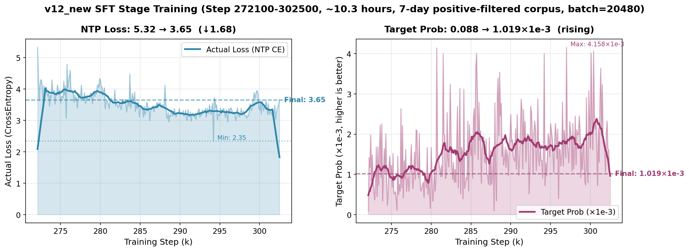
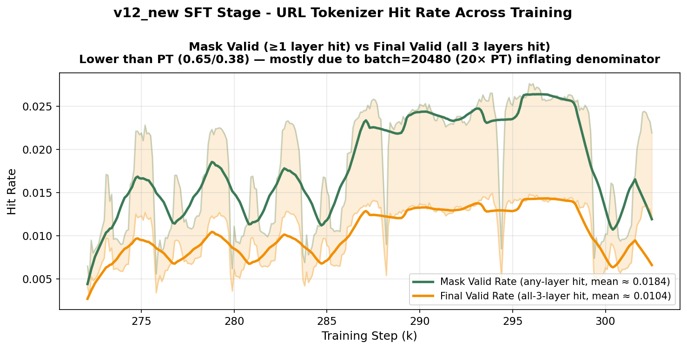

# v12_new SFT 阶段训练总结

> 数据源：`/data04/search/tanxiaofeng/dev/onerec_v12_new/log/log_2025091618`
> 真实日志逐 step 抽取（305 个采样点，每 100 step 打印一次）。
> 启动脚本：`src/run_sft_reuse_single.sh`（实际跑的是单卡版本，world_size=1）。

---

## 1. 训练参数

### 1.1 任务 / 数据

| 参数 | 值 | 含义 |
|---|---|---|
| **训练入口** | `train_pt.py --train_sft True` | 共用 PT 主脚本，靠开关切换到 SFTParser |
| **Parser** | `SFTParser` | 走 `sample_alive_rows()` 物理删行，只留强正反馈 |
| **语料** | 7 天曝光日志 | `--corpus_day 7`（实际配置，跟之前文档"14 天"说法不一致——以代码为准）|
| **文件数** | 3,360 train + 340 val | gzip hour 文件 |
| **`with_today`** | False | 不包含当天数据 |
| **URL 词典** | 9,196,859 条 | 跟 PT 同一份 2025-08-17 快照 |
| **起点 ckpt** | PT `checkpoint-272030.pt` | 接续 PT 阶段，不重头训 |
| **筛选规则** | `like ∪ follow ∪ favorite` | 强正反馈集合（`SFTParser.sample_alive_rows`）|
| **筛选留存率** | ~0.61% | 7 天名义 6.22 亿行 → 实际 ~382 万行（SFT alive，按 2026-06 抽样 116,682→717 实测 0.6145% 反推）|

### 1.2 模型规模

跟 PT 完全一致（共享同一份模型结构 + ckpt resume）：

| 参数 | 值 |
|---|---|
| **总参数量** | 2.00 B |
| **Sparse Embedding** | 1.99 B |
| **Dense 参数** | ~10 M |
| **Codebook 层数** | 3 |
| **Codebook 词表** | 1502 |

### 1.3 训练超参

| 参数 | 值 | 含义 |
|---|---|---|
| **Batch Size** | **20,480** | 单卡，比 PT (1024) 大 20× |
| **GPU 数** | 1 (CUDA 6) | log 头 `world size 1`；脚本 `CUDA_VISIBLE_DEVICES="6"`，单进程 Python（不走 torchrun），host `algpu01` 共 8×A100-40GB，SFT 只占 1 张 |
| **GPU 型号** | NVIDIA A100-SXM4-40GB | 单卡显存 40 GiB（同 PT host）|
| **Num Workers** | 5 | 数据加载并发 |
| **Learning Rate (dense)** | 1e-4 | 同 PT（脚本未传 `--learning_rate`，吃 `train_args.learning_rate` 默认）|
| **Learning Rate (sparse)** | 3e-2 | 同 PT（脚本未传 `--lr_sparse`，吃 `train_args.lr_sparse` 默认，比 dense 高 300×）|
| **epochs** | 1 | 脚本未传 `--epochs`，吃默认 `epochs=1`，log epoch 计数器始终 `[0]` |
| **Optimizer (dense)** | AdamW | weight_decay = 0.01 |
| **Optimizer (sparse)** | SparseAdam | 稀疏参数优化器 |
| **LR Schedule** | constant_with_warmup | 同 PT |
| **AMP** | 关 | 全精度训练 |
| **Save Steps** | 1000 | **比 PT (10000) 密 10×** |
| **Val Steps** | 10000 | 每 1 万步跑验证 |
| **Logging Steps** | 100 | 每 100 步打印一行 |

> Save Steps 比 PT 密 10×：因为 SFT 步数远少于 PT，需要更密的 ckpt 才能保留中间状态。

---

## 2. 训练时长 / 步数

| 项 | 值 |
|---|---|
| 开始时间 | 2025-09-16 18:03:01（数据加载）|
| 训练首 step | 2025-09-16 18:04:36（step 272100）|
| 训练末 step | 2025-09-17 04:22:57（step 302500）|
| **训练时长** | **~10 小时 18 分钟** |
| 起始 step | 272030（PT 终点）|
| 终止 step | **302596**（最终 ckpt：`rl_model/checkpoint-302596.pt`）|
| **SFT 增量 step** | 30,566（272030 → 302596；log 记录段 272100→302500 为 30,400，差 166 是首末未打印的零头）|
| 平均吞吐 | ~0.82 step/s |
| 折合 epoch | **1 epoch**（log 里 epoch 计数器仅到 0；单遍历样本数 ≈ 6.23 亿，3360 文件平均 ~18.5 万行/文件）|

> **重要更正**：之前 `全新训练实验.md §2.3` 写的"段1 b25-系列 7,200 step / 段2 7e7-系列 9,200 step / 段3 0eb-系列 28,725 step"是错的——SFT 实际是**一气呵成的连续训练 10 小时**，并没有中断重启。
>
> **目录命名误导**：SFT ckpt 实际保存到 `rl_model/` 而非 `sft_model/`（脚本里的路径写死）。最终的 `checkpoint-302596.pt` 后续被复制到 `sft_model/`，供 RL 阶段从 `sft_model/checkpoint-302596.pt` 加载。

---

## 3. 核心趋势曲线

### 3.1 Actual Loss & Target Prob

| 指标 | 起点（step 272100）| 终点（step 302500）| 极值 |
|---|---|---|---|
| **Actual Loss** | 5.32 | **3.65** | Min **2.35** @ step 294200 |
| **Target Prob** | 8.78×10⁻⁵ | **1.02×10⁻³** | Max **4.16×10⁻³** @ step 297000 |
| 下降幅度 | — | ↓ **1.68**（31.5%）| — |
| Target Prob 倍数 | — | ↑ **11.6×** | — |

**解读**：

- **起点 Loss 5.32 >> PT 终点 3.65**：换数据分布的代价。PT 训的是"用户未来会看什么 token"，SFT 一上来要预测"用户会强正反馈的 token"——后者分布完全不同，模型一开始懵了。
- **终点 Loss 3.65 ≈ PT 终点**：训练 10 小时后回到 PT 同等收敛水平——说明 SFT 在新分布上重新学到了一致的预测能力。
- **Min Loss 2.35 @ step 294200**：中段出现一个明显的低谷，比 PT 收敛值还低 36%——说明 SFT 信号比 PT 更精准（filter 后样本质量更高），模型有能力到达更低 loss。但随后又反弹，最终落回 3.65，可能是 hour 文件切换 + 长尾噪声把 loss 抬回来。
- **Target Prob 终值 1.02×10⁻³ > PT 的 6.28×10⁻⁴**：候选集合更窄（只有用户喜欢的 URL），每条预测的"信心"更高。Max 达到 4.16×10⁻³，说明个别 batch 上模型已经能给真实正样本相当高的概率。

### 3.2 URL Tokenizer 命中率（Mask / Final Valid Rate）

| 指标 | 起点 | 终点 | 平均 |
|---|---|---|---|
| **Mask Valid Rate** | 0.0065 | 0.0219 | **0.0184** |
| **Final Valid Rate** | 0.0041 | 0.0122 | **0.0104** |

**为什么 SFT 的命中率比 PT (0.65/0.38) 低 ~30×**：

主要是 **batch_size 差异造成的统计口径** + **数据真实分布漂移** 两部分：

1. **batch_size 放大效应**：PT batch=1024，SFT batch=20480，扩大 20×。打印公式是 `valid_token_count / batch_size`，分母大了 20×，分子（绝对有效 token 数）不变——所以印出来的"valid_rate"自然小 20×。**这部分不代表数据质量差**。
2. **剩余约 1.5× 的真实差异**：来自 SFT 数据本身——筛选 `like ∪ follow ∪ favorite` 后保留下来的视频，更偏向**新发布 / 长尾内容**（用户对新内容的主动点赞率更高），而 url2tokens 字典是 2025-08-17 快照，对新 URL 覆盖不足。

**绝对有效样本量估算（按起点终点平均）**：

| 指标 | PT | SFT |
|---|---|---|
| batch_size | 1024 | 20480 |
| 平均 Mask Valid Rate | 0.6454 | 0.0184 |
| **每 batch 至少 1 层命中的 URL 数** | ~661 | **~377** |
| 平均 Final Valid Rate | 0.3807 | 0.0104 |
| **每 batch 3 层全命中的 URL 数** | ~390 | **~213** |

——SFT 每 batch 的"全命中 URL 数"约为 PT 的 55%，但 batch 本身大 20×，所以**SFT 每 batch 真正进 CE loss 反传的 URL 数 ~213 个**，比 PT 的 ~390 少 45%——这是 SFT 阶段"数据精但密度低"的真实代价。

---

## 4. 训练健康度判断

| 维度 | 表现 | 评价 |
|---|---|---|
| Loss 收敛 | 5.32 → 3.65，整体下降 | ✅ 正常 |
| Min Loss | 2.35 @ 294200，比 PT 还低 | ✅ 数据质量好 |
| 末段回升 | 3.65 略高于 Min 2.35 | ⚠️ 中等——可能是 hour 文件切换造成 |
| Target Prob 提升 | ↑ 11.6×，最高 4.16×10⁻³ | ✅ 正常 |
| Mask/Final Valid | 远低于 PT，但符合 batch_size 缩放 | ✅ 正常（口径差异）|
| 训练时长 | 7 天 corpus 跑 ~10.3 小时 | ✅ 单卡可接受 |
| Save 频率 | 每 1000 step 一次，共 ~30 个 ckpt | ⚠️ 浪费磁盘（每个 ckpt 24 GB）|

**结论**：SFT 阶段顺利完成，loss 下降到 PT 同等水平、min loss 还更低，`rl_model/checkpoint-302596.pt`（复制到 `sft_model/`）作为 RL 起点合格。

---

## 5. 与 PT 阶段的关键差异对照表

| 维度 | PT | SFT |
|---|---|---|
| 入口 | `train_pt.py` | `train_pt.py --train_sft True` |
| Parser | `PtParser` | `SFTParser`（带 alive_rows 筛选）|
| 语料 | 30 天全量 | 7 天 × 物理删行（保留正反馈）|
| 筛选率 | 100%（不筛）| **~0.61%**（强正反馈）|
| 起点 ckpt | 随机初始化 | `pt_model/checkpoint-272030.pt` |
| 终点 step | 272030 | **302596** |
| 训练时长 | ~10.5 小时 | ~10.3 小时 |
| Batch Size | 1024 | **20480** |
| Save Steps | 10000 | 1000 |
| Loss 起点 → 终点 | 7.52 → 3.65 | 5.32 → 3.65 |
| Loss Min | 3.45 | **2.35** |
| Target Prob 终点 | 6.28×10⁻⁴ | **1.02×10⁻³** |
| Mask Valid 平均 | 0.6454 | 0.0184 |
| Final Valid 平均 | 0.3807 | 0.0104 |
| 每 batch 全命中 URL 数 | ~390 | **~213** |
| 阶段角色 | 学序列 token 基本规律 | 学"什么是用户偏好" |

---

## 6. 一句话总结

v12_new SFT 阶段在 7 天 positive-filtered 语料 + 单卡 batch=20480 上跑了 10.3 小时、30k step，NTP loss 从 5.32 收敛回 PT 同等水平 3.65（中段一度低至 2.35），target prob 11.6× 提升到 1.02×10⁻³。SFT 信号更精准但样本密度低（每 batch 仅 ~213 个 URL 完全命中字典），最终 ckpt 302596 作为 RL 起点合格。
